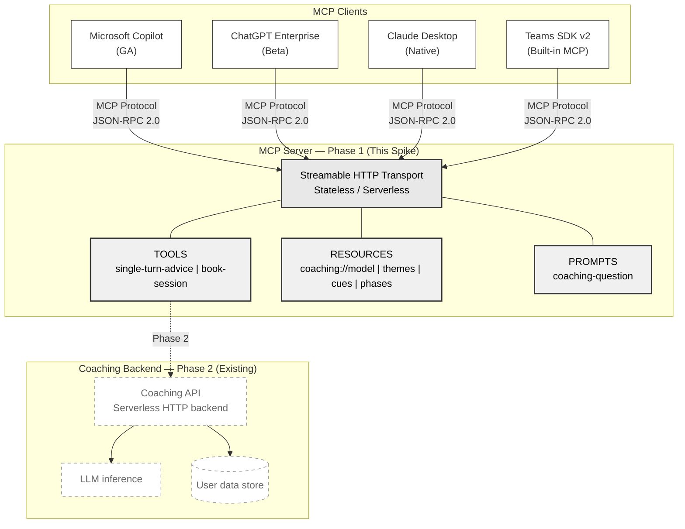

# Spike: MCP Server for a Coaching Product (Copilot / ChatGPT Enterprise / Claude)

> **Note (October 2026):** Written April 2026 as a one-day spike; anonymized and republished October 2026. The MCP spec has since changed (e.g. stateless became the default in the 2026-07-28 spec). Client, product and internal details have been removed, the domain data has been replaced with invented placeholder content, and one factual error has been fixed: the original listed Copilot Studio's transport as "WebSocket". MCP has no WebSocket transport, and Copilot Studio connects over Streamable HTTP.

**Author:** Andrey Popov
**Date:** 2026-04-03
**Time spent:** 6 hrs (1 day)

## Question

Should a coaching product build an MCP (Model Context Protocol) server so that its coaching is available inside enterprise AI platforms (Microsoft Copilot, ChatGPT Enterprise, Claude Desktop)? Which capabilities can safely be exposed, and what does a minimal implementation look like?

## Recommendation

An MCP server would let the coaching service reach employees inside AI tools they already use (Copilot, ChatGPT, Claude) without a separate integration for each platform. **Build an MCP server that exposes low-risk capabilities (single-turn advice, session booking and coaching-model reference data) as a Phase 1 distribution channel.** The protocol is mature enough: generally available in Copilot Studio, in beta in ChatGPT Enterprise and built into Claude. The TypeScript SDK also fits a TypeScript backend, and stateless Streamable HTTP runs on a serverless HTTP backend. **Defer full multi-turn coaching conversations** until verified user identity and a GDPR impact assessment are done.

**Additional finding (convergence):** Teams SDK v2 has built-in MCP support, so the same MCP server could also back a Teams bot integration. Two separate integration tracks could then become one server that Copilot, ChatGPT Enterprise, Claude Desktop and Teams bots all connect to. That replaces one adapter per platform with one server speaking one protocol.

## Architecture



**Phase 1 boundary (solid lines):** the MCP server with a stub backend. Tools return coaching-style responses and resources expose coaching-model data.

**Phase 2 boundary (dashed lines):** connect to the real coaching API. This needs verified user identity and a completed GDPR impact assessment first.

## Evidence

### 1. Working Proof of Concept

A working MCP server was built in TypeScript with `@modelcontextprotocol/sdk` v1.29.0. (In this public version the domain data is invented placeholder content; the structure is the same as the original.)

**Tools implemented** (both declare `outputSchema` and return `structuredContent`):
- `single-turn-advice` takes a question and an optional theme. It returns a coaching-style response with the detected cue, the suggested theme and the coaching phase.
- `book-session` books a coaching session with a date, a time slot and a coach type (ai/human/hybrid).

**Resources implemented:**
- `coaching://themes`: coaching themes
- `coaching://cues`: cue types the service detects in a question
- `coaching://phases`: phases of a coaching conversation
- `coaching://model`: overview of the coaching model
- `coaching://themes/{themeId}`: dynamic resource template for the detail of one theme

**Prompts implemented:**
- `coaching-question`: a structured prompt template that tells MCP clients to read the context first and then call the coaching tool

**Transports verified:**
- stdio, for Claude Desktop, Claude Code and MCP Inspector
- Streamable HTTP (stateless), for serverless and remote deployment

**Test results (all passing):**

1. **Initialize handshake:** returns capabilities for tools, resources and prompts.
2. **`single-turn-advice` tool call:** input *"I have too many things on my plate and keep missing deadlines. Where do I start?"* with theme=priorities. Output:
   ```json
   {
     "response": "If you could only finish one thing this week, which would it be, and what makes that one matter most?",
     "detectedCue": null,
     "suggestedTheme": "priorities",
     "phase": "orient"
   }
   ```
3. **`book-session` tool call:** input date=2026-04-10, timeSlot=14:00-15:00, coachType=ai. Output: `{ confirmed: true, sessionId: "sess_..." }`
4. **`coaching://model` resource read:** returns the full coaching model (phases, cues, themes, principles).
5. **`coaching://themes/{themeId}` dynamic resource:** returns the detail for one theme via the URI template.
6. **`prompts/list`:** returns the `coaching-question` prompt with its argument schema.
7. **Cue-triggering question:** input *"I feel blocked: my manager keeps overriding my decisions and I am not sure how to raise it"*. Output:
   ```json
   {
     "response": "If you could only finish one thing this week, which would it be, and what makes that one matter most?",
     "detectedCue": "obstacle",
     "suggestedTheme": "priorities",
     "phase": "reflect"
   }
   ```
   When the stub detects a cue, the phase moves from `orient` to `reflect`. This shows that a phase can change even in single-turn mode. It also shows the stub's limit: the theme falls back to a default, so the canned response does not fit the question.

- The health endpoint responds with the server status.
- The build compiles cleanly with no TypeScript errors.
- Round-trip latency was about 115 ms locally over HTTP with the stub backend. In production, the backend's LLM inference (seconds) would dominate latency.
- **stdio transport verified:** sequential JSON-RPC messages (initialize → tools/list → tools/call → resources/read → prompts/list) were piped through `node dist/stdio.js` and all returned valid responses. Claude Desktop and Claude Code start MCP servers the same way.

**Design note on stub vs live backend:** the spike uses hardcoded coaching responses to show the MCP interface shape without needing API credentials. The MCP layer is separate from the backend by design. To connect a live backend, replace `generateCoachingResponse()` with an HTTP call to the coaching service's API and map its result onto the same output shape. This is mostly a backend swap, but auth, error handling and latency still need work.

### 2. MCP Client Adoption Status (April 2026)

| Platform | MCP Support | Status | Transport |
|----------|-------------|--------|-----------|
| Microsoft Copilot Studio | GA | Tools + resources | Streamable HTTP |
| GitHub Copilot CLI | Supported | MCP server connections | stdio |
| ChatGPT Enterprise | Beta | Developer Mode, Business/Enterprise/Edu | Streamable HTTP |
| Claude Desktop | Native | All plans | stdio |
| Claude Code | Native | All plans | stdio |
| Teams SDK v2 | Built-in | Optional packages, MCP + A2A | Streamable HTTP |

*(Corrected from the original memo, which listed "HTTPS, WebSocket" for Copilot Studio and Teams SDK v2. MCP has no WebSocket transport.)*

**Key finding:** all three target platforms (Copilot, ChatGPT Enterprise and Claude) supported MCP. Because Teams SDK v2 has built-in MCP support, the Teams integration can use the same server.

*Note: adoption status comes from official announcements (linked in Sources). The spike was never connected to Copilot Studio or ChatGPT Enterprise. It was tested only at the protocol level, over stdio and over Streamable HTTP with curl.*

**Client rendering caveat:** MCP resources render differently in each client. Claude Desktop shows them in a sidebar, and Copilot Studio may rely on the `instructions` field. As a fallback, both the server's `instructions` string and the tool descriptions point to the coaching resources.

### 3. Coaching Capability → MCP Primitive Mapping

| Coaching concept | MCP Primitive | Rationale |
|-------------|---------------|-----------|
| Coaching themes | Resources (`coaching://themes`) | Read-only reference data, application-driven |
| Cue types | Resources (`coaching://cues`) | Context for understanding the coaching model |
| Conversation phases | Resources (`coaching://phases`) | Reference data that is not invoked |
| Single-turn advice | Tool (`single-turn-advice`) | Model-controlled, stateless, low privacy risk |
| Session booking | Tool (`book-session`) | Model-controlled, thin API wrapper |
| Full coaching conversation | DEFERRED | Needs multi-turn state, a GDPR impact assessment and verified identity |
| User memory/context | DEFERRED | User-specific personal data; needs verified identity and backend data protection |
| User progress / history | DEFERRED | User-specific, so it needs auth |

### 4. Architecture Decision: Stateless Single-Turn vs Stateful Coaching Loop

A full coaching conversation is a stateful loop. Each turn moves through phases, and the backend tracks where the conversation is. The key architecture question for MCP is whether to expose that loop.

**Option A: Stateless single-turn (RECOMMENDED for Phase 1)**

External platforms send one question and get one coached response back. No session state is kept between calls.

- How it works: the user asks a question in Copilot, Copilot calls the `single-turn-advice` tool, the MCP server returns a coaching response, and the exchange ends.
- Privacy: minimal risk. No conversation history passes through the MCP client, and every call is independent.
- Session state: none. The MCP transport runs in stateless mode (`sessionIdGenerator: undefined`), which works on serverless.
- Limitation: there is no multi-turn coaching arc, because the full phase progression cannot happen in one turn.

**Option B: Stateful coaching loop via MCP (DEFERRED)**

The MCP client would drive the whole coaching arc across turns.

There are three ways to manage the state:

| Approach | How | Pros | Cons |
|----------|-----|------|------|
| **Client-side state** | The MCP client (Copilot/ChatGPT) keeps the conversation context | No server state needed | Third-party AI processes all coaching content (GDPR risk); the client must understand phase transitions |
| **Server-side sessions** | The MCP server keeps a session via the `Mcp-Session-Id` header | The server controls the coaching arc | Needs persistent compute rather than serverless; needs session affinity; adds latency |
| **Hybrid: session token** | The MCP server returns an encrypted session token with each response and the client sends it back | Stateless server, with state carried in the request | The token grows with the conversation; encryption overhead; complex to implement |

**Why deferral is correct:**
1. Client-side state sends coaching content, which is sensitive personal data, to third-party AI models. There is no legal basis for that yet.
2. Server-side sessions need verified user identity, because user data must be protected per user.
3. No GDPR impact assessment has been done for processing coaching data through third-party platforms.
4. Single-turn advice is still useful. It gives an entry point equivalent to the reflective step: it spots a pattern and asks a coaching question, without the multi-turn listening that comes before it. It is a meaningful subset, though not the full arc.

**What happens when a Copilot user asks a follow-up?** Each call is independent. The MCP client's own context window keeps the conversation going, but the coaching server treats every call as a new interaction. This is intended: it keeps coaching state from leaking to the MCP client platform.

### 5. Technology Stack Fit

| Component | Coaching backend | MCP SDK | Fit |
|-----------|-----------|---------|-----------|
| Language | TypeScript | TypeScript SDK v1.29.0 | Same language |
| Compute | Serverless HTTP backend | Stateless Streamable HTTP | Runs on serverless |
| Auth | Existing OAuth-based identity | MCP OAuth 2.1 spec | Compatible in principle |
| Transport | HTTP | Streamable HTTP (stateless) | Serverless-ready |

## Options Evaluated

| Option | Description | Pros | Cons | Fit |
|--------|-------------|------|------|-----|
| **A. Build Phase 1 MCP** | Expose low-risk capabilities now | Immediate distribution channel; the Teams integration can share the server | Single-turn only until auth and the impact assessment are done | **RECOMMENDED** |
| B. Defer entirely | Wait for the auth model and the impact assessment | No privacy risk | Misses the market window, since enterprise Copilot/ChatGPT customers increasingly expect MCP | Not recommended |
| C. Full coaching via MCP | Expose multi-turn coaching immediately | Maximum capability | GDPR risk because third-party AI sees coaching content; no identity model yet | Premature |
| D. Custom API instead of MCP | Build a proprietary integration for each platform | Full control | N platforms means N integrations, with no ecosystem benefit | Poor fit |

## Tradeoffs of Recommendation

**What we gain:**
- Reach into Copilot (GA), ChatGPT Enterprise (beta) and Claude Desktop (native), three enterprise platforms
- The same language as a TypeScript backend, with stateless deployment on serverless
- Discoverability: the coaching service can be listed in MCP registries

**What we accept/lose:**
- Phase 1 offers only single-turn advice and booking, with no multi-turn coaching arc via MCP
- Coaching quality may be lower without the full arc (one question instead of a guided multi-step conversation)
- The auth model must be designed before any user-specific data (memory, history) is exposed
- A GDPR impact assessment is needed before any coaching content flows through third-party MCP clients
- Third-party AI platforms sit between the user and the coaching, so quality may drop compared with the direct product experience
- MCP-originated interactions must be included in the product's existing anonymized aggregate reporting
- This spike has no security controls (input validation, rate limiting, auth). A production deployment needs hardening per the [OWASP MCP Security Guide](https://genai.owasp.org/resource/a-practical-guide-for-secure-mcp-server-development/): input sanitization, per-tool rate limits, OAuth 2.1 and transport-level TLS

## Open Questions

1. **Auth model:** how do MCP clients authenticate users? A platform-level service account, or pass-through of the user's identity? The answer depends on the product's identity design.

2. **Data residency:** where do the MCP client platforms process coaching data? Each platform needs its own assessment for GDPR Articles 44-49.

3. **Training opt-out:** do Copilot and ChatGPT Enterprise use MCP tool responses for model training? Each platform needs a data processing agreement.

4. **Teams SDK v2 convergence:** if the Teams bot uses MCP natively, does the MCP server fully replace a bot-specific coaching endpoint, or do the two coexist?

5. **Monetization gating:** should MCP access depend on the subscription tier?

6. **Prompt injection:** the `question` field accepts any string. Once a real LLM is connected, prompt injection could try to extract the coaching system prompt or override coaching behavior. Production needs a maximum input length, content filtering and a hardened system prompt. See the [OWASP MCP Guide](https://genai.owasp.org/resource/a-practical-guide-for-secure-mcp-server-development/) for ways to mitigate this.

7. **Right to erasure:** when Phase 2 connects MCP to the real backend, the backend's existing deletion mechanism must also cover MCP-originated data (GDPR Article 17).

8. **Coaching model IP exposure:** MCP resources expose the coaching model (principles, phases, cues and themes). This is the coaching *model*, not user coaching *content*, so it is comparable to API documentation. Even so, the product owner should confirm that they are comfortable with this, because any connected platform can read these resources.

## Recommended Next Steps (If Approved)

### Week 1: Spike → Working Alpha
1. Connect `single-turn-advice` to the real coaching API (replace the stub with an HTTP call).
2. Add authorization following the MCP authorization spec. Start with API-key validation and move to full OAuth 2.1.
3. Deploy the MCP server as a stateless HTTP service on the existing serverless platform.
4. Test end to end with Claude Desktop (stdio) and MCP Inspector (HTTP).

### Week 2: Client Integration + Privacy
5. Register the server in Copilot Studio and check that tools and resources render correctly.
6. Add a user-specific, read-only resource gated by auth.
7. Start the GDPR impact assessment for coaching data that flows through MCP clients.
8. Evaluate Teams SDK v2 convergence: can one MCP server serve both the Teams bot and standalone clients?

### Week 3+: Production Hardening
9. Input validation (maximum question length, prompt-injection guardrails), rate limiting, an error-handling wrapper and the OWASP MCP security checklist
10. Per-user data protection, once verified identity is available
11. Entitlement gating, so MCP access is scoped by subscription tier
12. Monitoring and an audit trail for MCP-originated access

## Process Note

The spike went through research (the MCP landscape, templates and security), then implementation, then several rounds of quality review that found and fixed a number of failure modes before submission.

The architecture is scoped and the security questions are documented. The remaining work is to connect the live backend and test with Copilot Studio.

## Sources

Sources as of April 2026:

- [MCP Official Docs](https://modelcontextprotocol.io/docs/getting-started/intro): protocol specification
- [MCP TypeScript SDK v1.x](https://github.com/modelcontextprotocol/typescript-sdk/tree/v1.x): the SDK used in this spike
- [Copilot Studio MCP GA Announcement](https://www.microsoft.com/en-us/microsoft-copilot/blog/copilot-studio/model-context-protocol-mcp-is-now-generally-available-in-microsoft-copilot-studio/)
- [ChatGPT Enterprise MCP Beta](https://help.openai.com/en/articles/12584461-developer-mode-apps-and-full-mcp-connectors-in-chatgpt-beta): OpenAI Developer Mode
- [Teams SDK v2 MCP Support](https://devblogs.microsoft.com/microsoft365dev/announcing-the-updated-teams-ai-library-and-mcp-support/): built-in MCP
- [MCP Authorization Specification](https://modelcontextprotocol.io/specification/2025-03-26/basic/authorization): OAuth 2.1
- [OWASP MCP Security Guide](https://genai.owasp.org/resource/a-practical-guide-for-secure-mcp-server-development/): security best practices
- [MCP Inspector](https://github.com/modelcontextprotocol/inspector): testing tool
- [15 Best Practices for MCP Servers](https://thenewstack.io/15-best-practices-for-building-mcp-servers-in-production/): production patterns
- [AWS Multi-Tenant MCP Server](https://github.com/aws-samples/sample-multi-tenant-saas-mcp-server): multi-tenancy reference
- [MCP Privacy Gap Analysis](https://medium.com/ai-insights-cobet/the-mcp-privacy-gap-how-model-context-protocol-creates-hidden-data-threats-aa802e1b3cf8): privacy considerations
